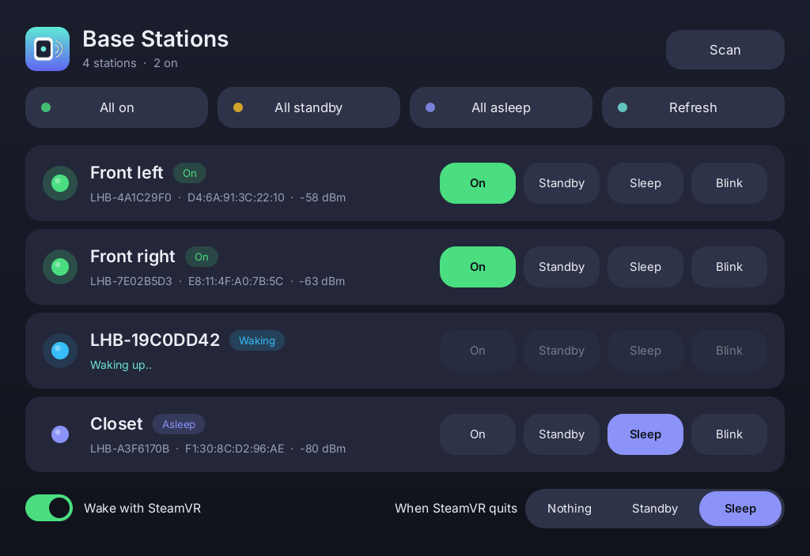

# Lighthouse Control (`lhctl`)

Turn SteamVR **Base Station 2.0**s on / standby / sleep from the **Steam Frame**, over Bluetooth LE,
from a **Base Stations** tab in the SteamVR dashboard.



- Lists nearby stations (`LHB-*`), shows their power state, and lets you set On, Standby or Sleep for each station or for all of them.
- **Blink** flashes a station's LED so you can tell which one is which.
- **Wake with SteamVR**: turns the stations on when SteamVR starts.
- **When SteamVR quits**: does nothing, or puts the stations in standby or to sleep.
- Runs as a small background service. It waits for SteamVR and adds the tab while SteamVR runs, the same way Babble Frame Runtime adds its tab.

## Install (on the Frame)

Desktop Mode → Konsole:

```bash
git clone <this repo> lhctl && cd lhctl
./packaging/install.sh                 # builds the Flatpak with flatpak-builder and installs it
# or, with a bundle from GitHub Actions:
./packaging/install.sh lhctl.flatpak
```

The installer runs `lhctl probe`, then enables `~/.config/systemd/user/lhctl.service`.
Open the SteamVR dashboard and look for **Base Stations**. Tap **Scan** once; after that, stations are remembered.

Logs: `journalctl --user -u lhctl -f` · Uninstall: `./packaging/uninstall.sh [--purge]`

## CLI

```
flatpak run com.phoenixnet_labs.LighthouseCtl probe            # SteamVR + Bluetooth reachable?
flatpak run com.phoenixnet_labs.LighthouseCtl scan
flatpak run com.phoenixnet_labs.LighthouseCtl on|standby|sleep|blink [AA:BB:CC:DD:EE:FF ...]
flatpak run com.phoenixnet_labs.LighthouseCtl preview out.png  # render the tab with sample data
```

## Config

`~/.config/lhctl/config.ini`: the toggles, plus one section per station. Set `nickname=` to rename
a station (for example `Front left`). The change shows up the next time the service restarts.

## How it works

| Piece | What |
|---|---|
| `src/ble.*` | BlueZ over D-Bus (GIO). Scans with an LE discovery filter, connects, then writes `0x01`/`0x02`/`0x00` to characteristic `…1525…` and reads the state byte back. Blink writes `0x00` to `…8421…`. |
| `src/model.*` | Station list, background jobs (one thread per station), settings persistence. |
| `src/overlay.*` | OpenVR `VRApplication_Background` client. It never starts SteamVR, so it just retries until SteamVR is up. It owns the dashboard tab, handles mouse and scroll, and runs auto on/off. |
| `src/ui.*`, `src/canvas.*` | 1024×704 software-rendered tab (stb_truetype + Inter), uploaded with `SetOverlayRaw`. It redraws only on change. |

State bytes: `0x00` sleep, `0x02` standby, `0x0b` on, `0x01/0x08/0x09` booting.

## Troubleshooting

`lhctl probe` checks each layer:

- **Bluetooth fails**: the Flatpak needs `--system-talk-name=org.bluez`, which is in the manifest. Check that `bluetoothctl show` says `Powered: yes`.
- **OpenVR runtime NOT FOUND**: the sandbox can't read `~/.config/openvr/openvrpaths.vrpath`.
- **SteamVR fails while SteamVR is running**: the sandbox is getting in the way of SteamVR's IPC (PID namespace, shm, sockets). Re-run the installer with `--unsandboxed`. The service will then run the same binary from the Flatpak install directly on the host, the way BFR runs.

## Build elsewhere

```bash
cmake -S . -B build -DOPENVR_LIB_DIR=/path/to/openvr/bin/linux64 && cmake --build build
```

## Licenses

lhctl: MIT. OpenVR SDK (`third_party/openvr`): BSD-3-Clause. stb: MIT / public domain. Inter font: SIL OFL 1.1.
